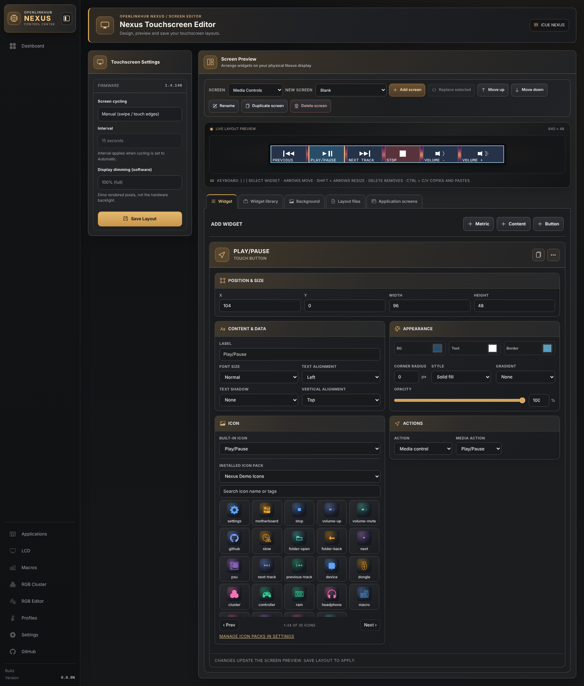
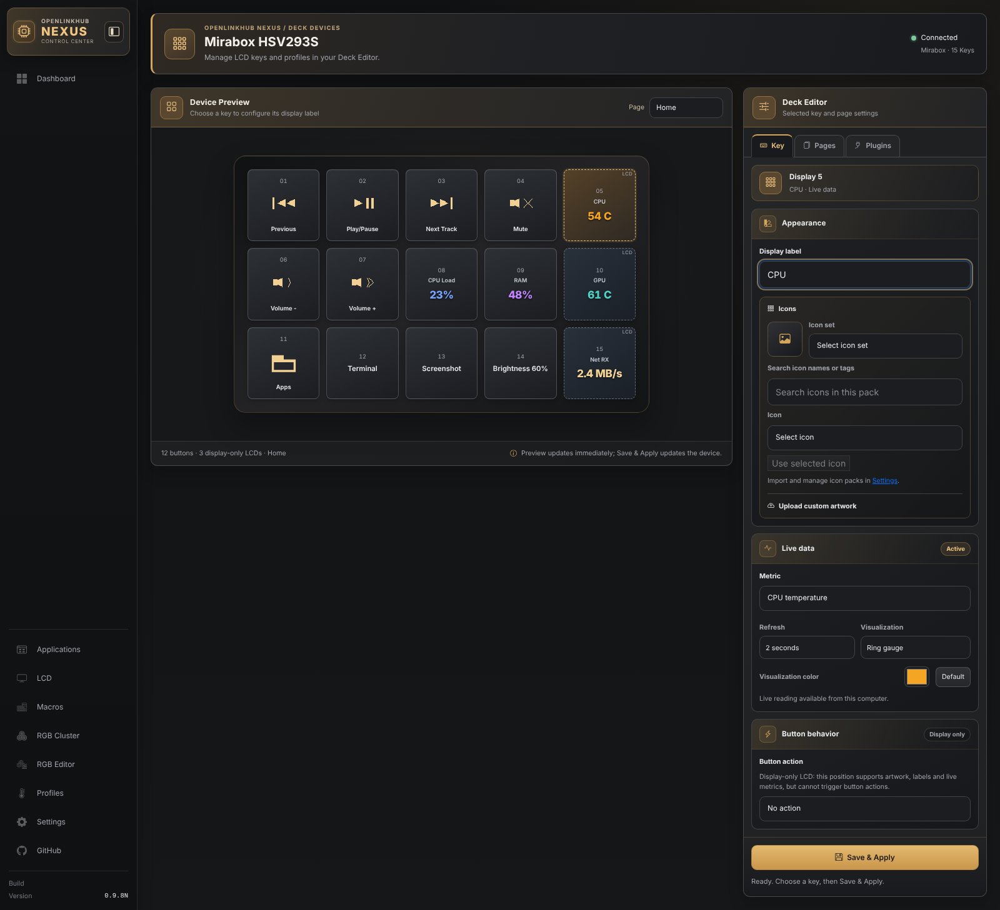
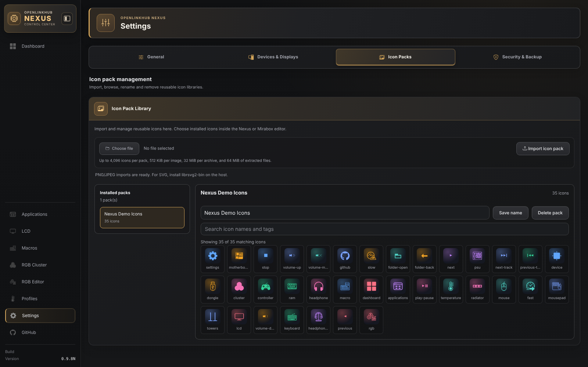
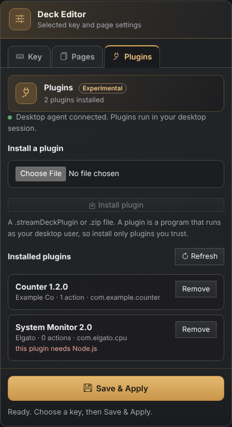
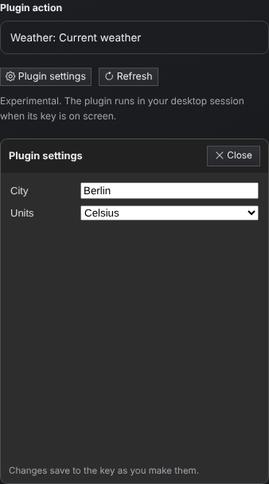

# OpenLinkHub Nexus — Enhanced Linux Hardware Control

> **Independently maintained fork** of [OpenLinkHub by Nikola Jurkovic](https://github.com/jurkovic-nikola/OpenLinkHub). This repository adds experimental Corsair iCUE NEXUS customization while preserving the original project's broader Linux hardware-control capabilities.

[](https://github.com/avonderau/OpenLinkHub-Nexus/actions/workflows/nexus-tests.yml)

## What is different in this fork?

- **Corsair iCUE NEXUS:** editable 640 × 48 custom screens with metrics, text, bars, graphs, clocks, images, buttons, per-widget colors and gradients, and touch/swipe navigation. Uploaded background images can be static or animated GIFs.
- **Mirabox and Elgato Stream Deck LCD keys (Elgato: experimental, not hardware-tested):** editable key pages, custom PNG/JPEG artwork, keyboard shortcuts, saved macros and media actions. Per-key live metrics support **Value only, Line graph, Bar graph, Fuel gauge, and Ring gauge**, including a per-key visualization color picker. Existing graph layouts are preserved.
- **Live telemetry:** CPU/GPU temperatures and utilization, fan/pump readings, memory, network and disk throughput (subject to host sensor availability).
- **Automated checks:** Go and Deck tests, Nexus editor UI tests, security checks and upstream compatibility tests.

- **Shared icon-pack library:** import, rename and delete reusable PNG, JPEG and SVG icon packs (up to 4,096 icons per pack, 32 MiB ZIP upload) and Stream Deck `.streamDeckIconPack` archives in **Settings → Icon Packs**; select their icons in either device editor. SVG import needs the optional Linux `rsvg-convert` utility (`librsvg2-bin`) and converts the artwork to PNG.

For setup and feature details, see the [Nexus development notes](docs/nexus-fork.md), [Deck plugins (experimental)](docs/deck-plugins.md), [Deck metric guide](docs/deck-live-metrics.md), and [Deck action guide](docs/deck-actions.md).

## Screenshots

**Nexus touchscreen editor:** arrange widgets on the 640 × 48 screen, style them (fill, gradient, corner radius, opacity), and pick icons from built-in glyphs or an installed icon pack with the paged picker.



**Deck editor (Mirabox shown):** media, folder, launch and keyboard keys, plus live metric keys with a per-key visualization and color. The right-hand column of this model is display-only LCDs.



**Icon pack library (Settings → Icon Packs):** import, browse, rename and delete icon packs shared by both editors.



**Deck plugins (experimental):** install OpenDeck/Stream Deck plugins from the Deck editor; they run in your desktop session through the desktop agent. See [Deck plugins](docs/deck-plugins.md).

<p>
  
  
</p>

<sub>Editor screenshots were captured from this fork's WebUI with sample layouts and readings.</sub>

**Development status:** The features described here refer to the repository's development code; published release assets may lag behind `main`. Nexus and Deck customization remains under active development, and physical-device actions and desktop integration should be tested on real hardware. For **Open URL** and **Launch Application** buttons when OpenLinkHub runs as a background service, see the [local Nexus desktop agent setup](docs/nexus-desktop-launch.md). These buttons open on the computer hosting OpenLinkHub, not on a separate WebUI client. Do not assume all upstream installation packages include these features.

See [Nexus development notes](docs/nexus-fork.md) for details and limitations.

## Installation of this fork

To build **this fork** from source, follow the manual dependency instructions below, then use:

```bash
git clone https://github.com/avonderau/OpenLinkHub-Nexus.git
cd OpenLinkHub-Nexus
CGO_CFLAGS_ALLOW='-fno-strict-overflow' go build -o OpenLinkHub .
```

For the official fork build, use the **[OpenLinkHub Nexus releases](https://github.com/avonderau/OpenLinkHub-Nexus/releases)**. The latest fork release is **`0.9.5N`** (built on the fork's earlier `0.9.4N` release; `N` distinguishes this independently maintained version from upstream OpenLinkHub).

**Native packages (Linux amd64):** Release `0.9.5N` provides a `.deb` for modern Debian/Ubuntu/Linux Mint and an `.rpm` for Fedora-compatible distributions, along with the portable tarball. On a conventional systemd installation, download the appropriate package and matching `.sha256` file from [release 0.9.5N](https://github.com/avonderau/OpenLinkHub-Nexus/releases/tag/0.9.5N) and verify its checksum before installing:

```bash
# Debian, Ubuntu or Mint:
sha256sum -c OpenLinkHub-Nexus_0.9.5N_amd64.deb.sha256
sudo apt install ./OpenLinkHub-Nexus_0.9.5N_amd64.deb

# Fedora, RHEL or compatible:
sha256sum -c OpenLinkHub-Nexus-0.9.5N-1.x86_64.rpm.sha256
sudo dnf install ./OpenLinkHub-Nexus-0.9.5N-1.x86_64.rpm
```

**Compatibility:** These packages wrap the existing Linux amd64 release executable, which requires **glibc 2.38 or newer**. This excludes, for example, Debian 12 and RHEL 9. Use a distro with a compatible libc and device libraries. RPM's auto-generated ELF dependencies and DEB's libc dependency enforce this requirement. 

**Before migrating from another installation:** Back up `config.json`, device profiles, macros and saved Nexus layouts. The native packages install the `OpenLinkHub.service` system service and may conflict with existing manual, upstream or user-service installations. See the [0.9.5N release notes](docs/releases/0.9.5N.md) for details. For immutable distributions, use the portable bundle instead of DEB/RPM.

The fork's [remote installer](https://github.com/avonderau/OpenLinkHub-Nexus/blob/main/remote-install.sh) downloads release assets **from this repository**, not upstream. Review the script before running it. Existing upstream package managers and releases do **not** contain these Nexus changes.

See the [0.9.4N security review](docs/security-review-0.9.4N.md) and [desktop launcher guide](docs/nexus-desktop-launch.md) for installation and security boundaries.

Do not use the upstream installer, PPA, Copr, or upstream releases if you intend to install this fork's experimental features. The legacy installation sections below document **upstream distribution channels**, not builds of this fork.

## AI-Assisted Development

This fork of OpenLinkHub is developed with assistance from OpenAI's ChatGPT.

AI tools are used to assist with code development, debugging, testing, documentation, and identifying potential improvements. Development decisions, project direction, and acceptance of changes remain under human oversight.

AI-generated or AI-assisted code should not be assumed to be free of defects. Contributions and changes are subject to testing and review, and some features may require validation on physical hardware.

This project is independently maintained and is not affiliated with or endorsed by OpenAI, Corsair, or the original OpenLinkHub maintainers.

## Original project and attribution

The original OpenLinkHub project was created and is maintained upstream by [Nikola Jurkovic](https://github.com/jurkovic-nikola/OpenLinkHub). This fork is not an official upstream release or an official Corsair product. Original copyright notices and the repository's GPL license remain in place.

---

An open-source Linux interface for iCUE LINK hubs and other Corsair AIOs and hubs.
Manage RGB lighting, fan speeds, system metrics, as well as keyboards, mice, and headsets via a web dashboard.

[](https://github.com/jurkovic-nikola/OpenLinkHub/actions/workflows/go.yml)
[](https://discord.gg/mPHcasZRPy)

**Available in other languages:** [Portuguese (Brazil)](README-pt_BR.md)

## Features

- Web-based UI accessible at `http://localhost:27003`
- Control AIO coolers, fans, hubs, pumps, LCDs and RGB lighting
- Manage keyboards, mice and headsets
- Support for DDR4 and DDR5 memory
- Custom fan profiles, temperature sensors and RGB editor
- If you need system tray menu - https://github.com/jurkovic-nikola/openlinkhub-tray
- XENEON EDGE App - https://github.com/jurkovic-nikola/openlinkhub-xeneon
- [Supported device list](docs/supported-devices.md)
- [SCUF Controller Audio Config](docs/scuf-controller.md)
- [KDE System Monitor Sensor Face](https://github.com/jurkovic-nikola/openlinkhub-sensorfaces)
- [Memory DDR4 / DDR5](docs/memory-configuration.md)
- [Motherboard PWM](docs/motherboard-pwm.md)
- [OpenRGB Integration](openrgb/README.md)
- [XENEON EDGE KDE](docs/xeneon-edge-kde.md)

See [Screenshots](#screenshots) for this fork's WebUI.

## Info
- This project was created out of necessity to control fans and pumps on workstations after switching everything to Linux.
- I take no responsibility for this code at all. Use this at your own risk.
- Most of the devices are actually tested on live hardware.
- Take care and have fun!
- This project is not an official Corsair product.
## Upstream installation (not this fork)

The following installer and package-manager commands are retained for reference to the **original upstream project**. They will not install this fork’s custom Nexus functionality.

### Upstream installation (recommended)
```bash
curl -fsSL https://raw.githubusercontent.com/jurkovic-nikola/OpenLinkHub/main/remote-install.sh | bash
```
This script will:
- Create a system group named openlinkhub
- Add your current user to openlinkhub 
- Install OpenLinkHub in your home directory. 
- Create a user systemd service 
- Copy 99-openlinkhub.rules to /etc/udev/rules.d/ 
- Start the service after installation. 
- You can use this script for installation or upgrade purposes.
- Before running this script, uninstall any previously installed versions of OpenLinkHub

### Upstream installation (automatic)
1. Download either .deb or .rpm package from the latest Release, depending on your Linux distribution
2. Open a terminal
3. Navigate to the folder where the package is downloaded
```bash
# Debian-Based (deb)
$ sudo apt install ./OpenLinkHub_?.?.?_amd64.deb 

# RPM-based (rpm)
$ sudo dnf install ./OpenLinkHub-?.?.?-1.x86_64.rpm
```

### Upstream installation (PPA)
```bash
$ sudo add-apt-repository ppa:jurkovic-nikola/openlinkhub
$ sudo apt update
$ sudo apt-get install openlinkhub
```

### Upstream installation (Copr)
```bash
$ sudo dnf copr enable jurkovic-nikola/OpenLinkHub
$ sudo dnf install OpenLinkHub
```

## Manual installation and build requirements
### 1. Requirements
- libudev-dev
- usbutils
- libpipewire-dev
- pkg-config
- go 1.26.0 - https://go.dev/dl/
```bash
# Required packages (deb)
$ sudo apt-get install libudev-dev
$ sudo apt-get install usbutils
$ sudo apt-get install libpipewire-0.3-dev
$ sudo apt-get install pkg-config

# Required packages (rpm)
$ sudo dnf install libudev-devel
$ sudo dnf install usbutils
$ sudo dnf install pipewire-devel
$ sudo dnf install pkg-config
```
Or use the provided devcontainer in VScode. This is useful for immutable distributions.
### 2. Build & install
```bash
$ git clone https://github.com/avonderau/OpenLinkHub-Nexus.git
$ cd OpenLinkHub-Nexus/
$ CGO_CFLAGS_ALLOW='-fno-strict-overflow' go build -o OpenLinkHub .
$ chmod +x install.sh
$ sudo ./install.sh
```

### 3. Upstream release archives (not this fork)
```bash
# Download latest build from https://github.com/jurkovic-nikola/OpenLinkHub/releases/latest
$ wget "https://github.com/jurkovic-nikola/OpenLinkHub/releases/latest/download/OpenLinkHub_$(curl -s https://api.github.com/repos/jurkovic-nikola/OpenLinkHub/releases/latest | jq -r '.tag_name')_amd64.tar.gz"
$ tar xf OpenLinkHub_?.?.?_amd64.tar.gz
$ cd /home/$USER/OpenLinkHub/
$ chmod +x install.sh
$ sudo ./install.sh
```
### 4. Immutable distributions (upstream release instructions) (Bazzite OS, SteamOS, etc...)
```bash
# Do not install RPM or DEB packages on immutable distributions, they will not work.
# This same procedure may be followed to update an existing installation.
# Download the latest tar.gz from the Release page, or use the following command to download the latest release.
$ wget "https://github.com/jurkovic-nikola/OpenLinkHub/releases/latest/download/OpenLinkHub_$(curl -s https://api.github.com/repos/jurkovic-nikola/OpenLinkHub/releases/latest | jq -r '.tag_name')_amd64.tar.gz"

# Extract the package to your home directory
$ tar xf OpenLinkHub_?.?.?_amd64.tar.gz -C /home/$USER/

# Go to the extract folder
$ cd /home/$USER/OpenLinkHub

# Make install-user-space.sh executable
$ chmod +x install-user-space.sh

# Run install-user-space.sh. Enter your password for sudo when asked to copy 99-openlinkhub.rules file
$ ./install-user-space.sh

# Restart 
$ systemctl reboot

# Check if service is running
$ systemctl status --user OpenLinkHub.service
```

### 5. Usage (non-immutable distributions)
```bash
sudo systemctl start OpenLinkHub.service
xdg-open http://127.0.0.1:27003
```

### 6. Configuration
`/opt/OpenLinkHub/config.json`
```json
{
  "debug": false,
  "listenPort": 27003,
  "listenAddress": "127.0.0.1",
  "cpuSensorChip": "k10temp",
  "manual": false,
  "frontend": true,
  "metrics": true,
  "resumeDelay": 15000,
  "memory": false,
  "memorySmBus": "i2c-0",
  "memoryType": 4,
  "exclude": [],
  "decodeMemorySku": true,
  "memorySku": "",
  "logFile": "",
  "logLevel": "info",
  "enhancementKits": [],
  "temperatureOffset": 0,
  "amdGpuIndex": 0,
  "amdsmiPath": "",
  "cpuTempFile": "",
  "graphProfiles": false,
  "ramTempViaHwmon": false,
  "nvidiaGpuIndex": [0],
  "defaultNvidiaGPU": 0,
  "enableGamepad": true,
  "enableMotherboard": false,
  "motherboardBiosOnExit": false,
  "appMonitor": false
}
```
- listenPort: HTTP server port.
- listenAddress: Address for HTTP server to listen on.
- cpuSensorChip: CPU sensor chip for temperature. `k10temp` or `zenpower` for AMD and `coretemp` for Intel
- manual: set to true if you want to use your own UI for device control. Setting this to true will disable temperature monitoring and automatic device speed adjustments.
- frontend: set to false if you do not need the WebUI console, and you are making your own UI app.
- metrics: enable or disable Prometheus metrics
- resumeDelay: amount of time in milliseconds for the program to reinitialize all devices after sleep / resume
- memory: Enable overview / control over the memory
- memorySmBus: i2c smbus sensor id
- memoryType: 4 for DDR4, 5 for DDR5
- exclude: list of device IDs in uint16 format to exclude from program control
- decodeMemorySku: set to false to manually define `memorySku` value.
- memorySku: Memory part number, e.g. (CMT64GX5M2B5600Z40)
- You can find the memory part number by running the following command: `sudo dmidecode -t memory | grep 'Part Number'`
- logFile: custom location for logging. Default is empty.
  - Defining `-` for logFile will send all logs to standard console output.
  - If you change the location of logging, make sure the application username has permission to write to that folder.
- logLevel: log level to log in console or file.
- enhancementKits: DDR4/DDR5 Light Enhancement Kits addresses.
- If your kit is installed in the first and third slot, the value would be: `"enhancementKits": [80,82],`. This value is a byte value converted from hexadecimal output in `i2cdetect`
  - When kits are used, you need to set `decodeMemorySku` to `false` and define `memorySku`
- temperatureOffset: Temperature offset for AMD Threadripper CPUs
- amdGpuIndex: GPU device index. You can find your GPU index via `amd-smi static --asic --json`
- amdsmiPath: Manual path to amd-smi binary (not recommended). A better way is to define `amd-smi` path in `$PATH` variable if missing.
- cpuTempFile: custom hwmon temperature input file, e.g. tempX_input. Use in combination with `cpuSensorChip`.
- graphProfiles: Setting this value to `true` will enable graph-based temperature profiles on `/temperature` endpoint and enable temperature interpolation.
- ramTempViaHwmon: Switch to true if you want to monitor RAM temperature via the hwmon system. With this option, you don't have to unload modules to get the temperature. (Require 6.11+ kernel)
- nvidiaGpuIndex: NVIDIA multi-gpu setup.
- defaultNvidiaGPU: default index of NVIDIA GPU, default is 0.
  - If you use vfio-pci/pass-through, you have to set it to -1 to avoid conflicts with NVIDIA modules.
- enableGamepad: Enable or disable Virtual Gamepad used for SCUF controllers.
- enableMotherboard: Enable control of motherboard PWM headers.
- motherboardBiosOnExit: Switch PWM headers to BIOS mode when program exits.
- appMonitor: Enable or disable Application Integration.

### 7. Progressive Web App (PWA) UI
The web UI supports installation as a progressive web app (PWA). With a supported browser, this allows the UI to appear as a standalone application.
Chromium-based browsers support PWAs; Firefox currently does not.
GNOME 'Web,' also known as 'Epiphany', is a good option for PWAs on GNOME systems.

## Uninstall
```bash
# Stop service
sudo systemctl stop OpenLinkHub.service

# Remove application directory
sudo rm -rf /opt/OpenLinkHub/

# Remove systemd file (file location can be found by running sudo systemctl status OpenLinkHub.service)
sudo rm /etc/systemd/system/OpenLinkHub.service
# or
sudo rm /usr/lib/systemd/system/OpenLinkHub.service

# Reload systemd
sudo systemctl daemon-reload

# Remove udev rules
sudo rm -f /etc/udev/rules.d/99-openlinkhub.rules
sudo rm -f /etc/udev/rules.d/98-corsair-memory.rules

# Reload udev
sudo udevadm control --reload-rules
sudo udevadm trigger
```
## Running in Docker
As an alternative, OpenLinkHub can be run in Docker, using the Dockerfile in this repository to build it locally. A configuration file has to be mounted to /opt/OpenLinkHub/config.json
```bash
$ docker build . -t openlinkhub
$ # To build a specific version, you can use the GIT_TAG build argument
$ docker build --build-arg GIT_TAG=0.1.3-beta -t openlinkhub .

$ docker run --privileged openlinkhub

# For WebUI access, networking is required
$ docker run --network host --privileged openlinkhub
```

## LCD
- LCD images / animations are located in `/opt/OpenLinkHub/database/lcd/images/`
## Dashboard
- Device Dashboard is accessible by browser via the link `http://127.0.0.1:27003/`
- Device Dashboard allows you to control your devices.
## RGB
- RGB configuration is located at `database/rgb/your-device-serial.json` file
- RGB can be configured via the RGB Editor in the Dashboard
## API
- OpenLinkHub ships with a built-in HTTP server for device overview and control.
- Documentation is available at [API Page](api/README.md)
