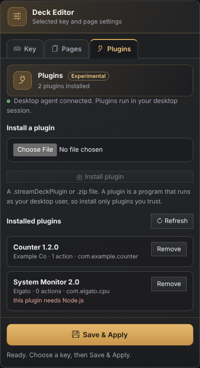
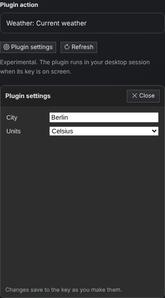

# Deck plugins (experimental)

Deck keys can run **action plugins** written for the Elgato Stream Deck SDK
or OpenDeck's OpenAction API. A plugin key shows whatever the plugin draws
(its image and title) and tells the plugin when it is pressed.

This is an early, experimental feature.

## How it works

Plugins never run inside the OpenLinkHub service. The **desktop agent**,
which already handles Open website and Launch application keys, also runs a
plugin host in your desktop session, as your user:

1. The service tells the agent which plugin keys are on the current page and
   when one is pressed. It talks to the agent over a second socket next to
   the launch socket (`runtime/nexus-desktop/deck-plugins.sock`), with the
   same permission and peer checks.
2. The agent starts each plugin the first time one of its keys appears. It
   speaks the Stream Deck WebSocket protocol to the plugin on `127.0.0.1`,
   using a random port and a random registration token for each launch.
   Connections from web pages (with a browser `Origin` header) and from
   other users' programs are refused, even though other users can see the
   token on the plugin's command line.
3. The plugin's titles, images, states and settings travel back to the
   service. The service accepts only bounded PNG or JPEG images and JSON
   object settings for keys that are actually on screen. SVG images are
   converted to PNG in your session with `rsvg-convert` when it is installed.

If the desktop agent is not running, plugin keys show "Plugin" or "Plugin
host offline" and every other Deck action keeps working.

## What runs

| Plugin type | Supported |
| --- | --- |
| OpenAction plugins with a Linux build (`CodePathLin` or `CodePaths`) | Yes |
| Node.js plugins (`CodePath` ending in `.js`, `.mjs` or `.cjs`) | Yes, with Node.js installed (`node` on your `PATH`). Most Elgato plugins need Node 20 or later |
| Hardware (device) plugins (`DeviceNamespace` in the manifest) | No. OpenLinkHub drives Deck hardware itself, and two drivers would fight over the same device |
| Windows-only (`.exe`) or macOS-only plugins | No |
| HTML-page plugins (`CodePath` ending in `.html`) | Not yet |
| Elgato Marketplace plugins with DRM | No. They only run inside Elgato's own app |
| Dials, touch strips, multi-actions, profiles | No |

Supported plugin messages: `setTitle`, `setImage`, `setState`,
`setSettings`, `getSettings`, `setGlobalSettings`, `getGlobalSettings`,
`sendToPropertyInspector`, `openUrl` (http and https only), `logMessage`,
`showAlert` and `showOk`. Plugins receive `willAppear`, `willDisappear`,
`keyDown`, `keyUp`, `didReceiveSettings`, `didReceiveGlobalSettings`,
`sendToPlugin`, `propertyInspectorDidAppear`,
`propertyInspectorDidDisappear`, `deviceDidConnect` and
`deviceDidDisconnect`.

Settings pages can send `setSettings`, `getSettings`, `sendToPlugin`,
`setGlobalSettings`, `getGlobalSettings`, `openUrl` and `logMessage`, and
receive `didReceiveSettings`, `didReceiveGlobalSettings` and
`sendToPropertyInspector`. A page is started the way the Stream Deck app
starts it, with `connectElgatoStreamDeckSocket` (or `connectSocket`).

On Decks that report key release (Elgato Stream Deck and the Mirabox
HSV293SV3), plugins get `keyDown` when a key goes down and `keyUp` when it
is let go, so hold actions such as push-to-talk work. The original Mirabox
HSV293S and the Ajazz AKP153 only report presses; there a press is sent as
`keyDown` immediately followed by `keyUp`, and hold actions do not work.

## Install a plugin

### From the Deck editor



1. Make sure the desktop agent is running (see
   [Nexus desktop launch](nexus-desktop-launch.md)). The **Plugins** tab
   shows whether it is connected.
2. Open the Deck editor and select the **Plugins** tab.
3. Choose a `.streamDeckPlugin` or `.zip` file (up to 48 MiB) and click
   **Install plugin**.

The editor sends the file to the service, which passes it to the desktop
agent. The agent checks the archive, then shows a confirmation dialog on
your desktop with the plugin's name, author, ID and actions. The plugin is
installed only if you click **Install** within 90 seconds. This stops any
other program or user that can reach the WebUI from installing code that
runs as you. The dialog needs `zenity` or `kdialog`; without either, install
from a terminal instead. As a second safeguard,
installs are only accepted from a browser on the computer running
OpenLinkHub, connecting directly to `127.0.0.1` or `::1`. A remote browser,
or one that goes through a reverse proxy, can see and remove plugins but
cannot install them.

The Plugins tab also lists every installed plugin with its version, author,
and why it cannot run if it cannot. Remove a plugin with its **Remove**
button. Keys that used it show "Plugin missing" until you install it again
or give them another action.

Installing a plugin that is already installed replaces it. Its keys on
screen restart with the new version.

### From a terminal

Run this **as your desktop user** (not with `sudo`):

```sh
/opt/OpenLinkHub/OpenLinkHub --install-deck-plugin ~/Downloads/com.example.plugin.streamDeckPlugin
```

The source can be a `.streamDeckPlugin` file (a zip archive) or an unpacked
`*.sdPlugin` folder.

### Where plugins go

Plugins are installed into `~/.local/share/OpenLinkHub/deck-plugins/`. The
installer refuses archives with absolute paths, `..`, links, more than one
plugin, or more than 256 MiB of content, and refuses hardware plugins. You
can also delete a plugin's folder there yourself. The agent notices added,
changed and removed plugins within a few seconds.

**A plugin is a program that runs with your user's permissions.** Install
only plugins you trust, preferably open-source ones.

## Use a plugin on a key

1. Make sure the desktop agent is running (see
   [Nexus desktop launch](nexus-desktop-launch.md)).
2. Open the Deck editor, select a key, and choose **Plugin action
   (experimental)** as the button action. Click **Refresh** if a newly
   installed plugin is missing.
3. Pick the plugin action and click **Save & Apply**.

## Plugin settings



Many plugins have their own settings page (Stream Deck calls it a property
inspector), for example to pick a city or sign in to a service. To open it:

1. Put the plugin action on a key and click **Save & Apply**. The key's page
   must be the one the Deck is showing, so the plugin is running for it.
2. Select the key and click **Plugin settings** under the plugin action.

The page opens inside the editor. Changes are saved to the key as you make
them; you do not need to click Save & Apply again. **Plugin settings** is
greyed out for actions that have no settings page.

The settings page is plugin code, so it is isolated:

- It runs in a sandboxed frame with its own opaque origin. It cannot read
  the WebUI, use your sign-in session, or call OpenLinkHub's APIs.
- Its files are served from the plugin folder by the desktop agent, under a
  random link that only works for that one key and expires after 30 minutes
  without use.
- It talks to its plugin through OpenLinkHub, which relays its messages to
  the desktop agent. The agent applies them only to that key and to that
  plugin's global settings. This works from any browser that can open the
  editor, including a remote one.

Settings that a plugin or its settings page saves for a key are stored in
that key's layout, so they survive restarts and are kept when you save the
layout from the editor. Global plugin settings are stored in
`~/.local/state/OpenLinkHub/deck-plugins/global-settings/`.

## Troubleshooting

- Each plugin's output goes to
  `~/.local/state/OpenLinkHub/deck-plugins/logs/<plugin UUID>.log`.
- The agent's own messages (plugin starts, exits and restarts) appear in the
  agent log described in [Nexus desktop launch](nexus-desktop-launch.md).
- A plugin that crashes is restarted with backoff. After five crashes in two
  minutes its keys show "Plugin crashed" until the agent restarts.
- The editor lists installed plugins that cannot run, with the reason (for
  example "this plugin needs Node.js").
